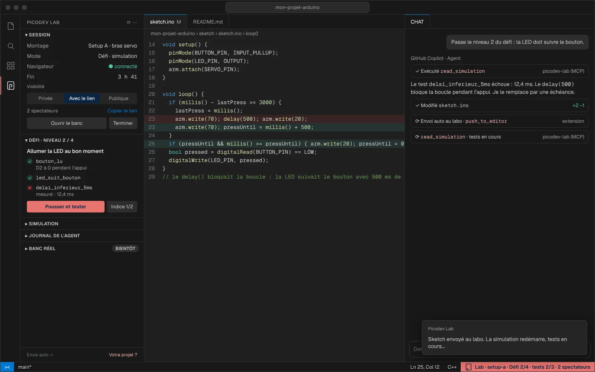
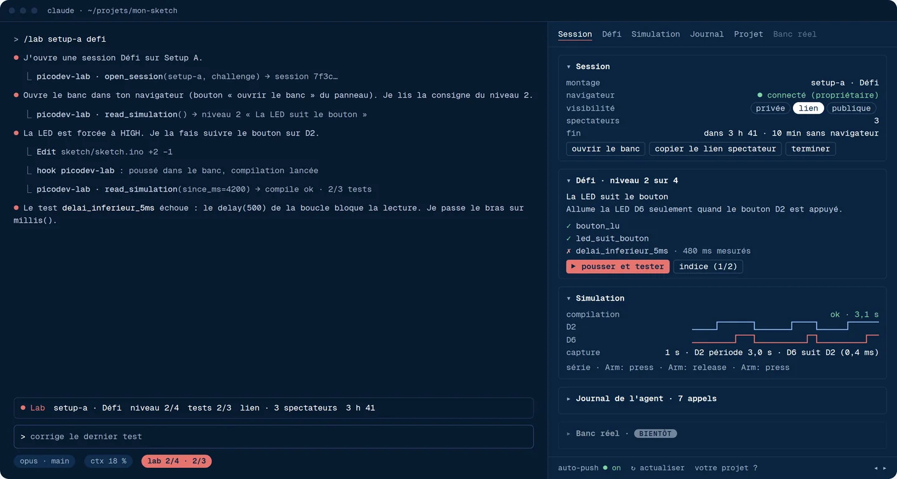

<p align="center"></p>

<p align="center"><a href="#français">Français</a> · <a href="#english">English</a></p>

## Français

**Picodev** conçoit l'électronique et le logiciel embarqué de ses clients, avec une usine logicielle : compilation reproductible, bancs de test pilotés à distance, agents.

**Picodev Lab** en est la démonstration : un banc Arduino dans votre navigateur, piloté par votre agent. Sans compte, sans carte. **[lab.picodev.fr](https://lab.picodev.fr)**

### Dans VS Code



Cherchez « Picodev Lab » dans les extensions, ou `code --install-extension picodev.picodev-lab`. Le MCP du labo est prêt pour Copilot en mode agent et pour Claude Code. → [picodev-lab-vscode](https://github.com/PICODEV-SAS/picodev-lab-vscode)

### Dans Claude Code



```
/plugin marketplace add PICODEV-SAS/picodev-lab-plugin
/plugin install picodev-lab@picodev-lab
```

puis `/lab`. → [picodev-lab-plugin](https://github.com/PICODEV-SAS/picodev-lab-plugin)

### Avec tout autre agent

Serveur MCP `https://lab.picodev.fr/mcp` (HTTP « streamable », sans compte).

| Dépôt | |
|---|---|
| [picodev-lab-vscode](https://github.com/PICODEV-SAS/picodev-lab-vscode) | Extension VS Code (Apache 2.0) |
| [picodev-lab-plugin](https://github.com/PICODEV-SAS/picodev-lab-plugin) | Plugin Claude Code (Apache 2.0) |
| [picodev-lab-client](https://github.com/PICODEV-SAS/picodev-lab-client) | Client TypeScript du MCP, commun aux deux (Apache 2.0) |
| [picodev-lab](https://github.com/PICODEV-SAS/picodev-lab) | L'éditeur et la simulation : notre version de [Velxio](https://github.com/davidmonterocrespo24/velxio), de David Montero Crespo (AGPLv3) |

*Les captures sont des aperçus.*

---

## English

**Picodev** designs electronics and embedded software for its clients, with a software factory: reproducible builds, remotely driven test benches, AI agents.

**Picodev Lab** shows it at work: an Arduino bench in your browser, driven by your AI agent. No account, no board. **[lab.picodev.fr](https://lab.picodev.fr/en/)**

### In VS Code


Search for "Picodev Lab" in the extensions, or `code --install-extension picodev.picodev-lab`. The lab's MCP server is ready for Copilot agent mode and for Claude Code. → [picodev-lab-vscode](https://github.com/PICODEV-SAS/picodev-lab-vscode)

### In Claude Code


```
/plugin marketplace add PICODEV-SAS/picodev-lab-plugin
/plugin install picodev-lab@picodev-lab
```

then `/lab`. → [picodev-lab-plugin](https://github.com/PICODEV-SAS/picodev-lab-plugin)

### With any other agent

MCP server `https://lab.picodev.fr/mcp` (streamable HTTP, no account).

| Repository | |
|---|---|
| [picodev-lab-vscode](https://github.com/PICODEV-SAS/picodev-lab-vscode) | VS Code extension (Apache 2.0) |
| [picodev-lab-plugin](https://github.com/PICODEV-SAS/picodev-lab-plugin) | Claude Code plugin (Apache 2.0) |
| [picodev-lab-client](https://github.com/PICODEV-SAS/picodev-lab-client) | TypeScript client of the MCP, shared by both (Apache 2.0) |
| [picodev-lab](https://github.com/PICODEV-SAS/picodev-lab) | The editor and the simulation: our version of [Velxio](https://github.com/davidmonterocrespo24/velxio), by David Montero Crespo (AGPLv3) |

*Screenshots are previews; the interface shown is in French.*

---

<p align="center"><a href="https://picodev.fr">picodev.fr</a> · <a href="https://picodev.fr/#contact">contact</a></p>
